# Image Processor

Консольная программа на C++20 для обработки 24-битных BMP-изображений без сжатия. Позволяет применять несколько фильтров подряд в порядке их указания.

## Сборка

Нужны CMake 3.20+ и компилятор с поддержкой C++20. Команды выполняются из корня проекта:

```bash
cmake -S . -B build -DCMAKE_BUILD_TYPE=Release -DBUILD_TESTING=OFF
cmake --build build -j 2
```

## Запуск

```bash
./build/image_processor input.bmp output.bmp [-filter параметры...]
```

Например, обрезать изображение и выделить границы:

```bash
./build/image_processor test_script/mydata/flowers.bmp output.bmp -crop 800 600 -edge 0.2
```

Папка для выходного файла должна существовать. Без фильтров программа сохраняет копию изображения. Краткая справка: `./build/image_processor --help`.

## Поддерживаемые фильтры

| Фильтр | Описание |
| --- | --- |
| `-crop width height` | Обрезка от левого верхнего угла. Размеры — положительные целые числа; изображение не увеличивается. |
| `-gs` | Перевод в оттенки серого. |
| `-neg` | Негатив: инверсия цветов. |
| `-sharp` | Повышение резкости. |
| `-edge threshold` | Выделение границ: белые контуры на чёрном фоне. Чем выше порог, тем меньше деталей; пример: `-edge 0.2`. |
| `-blur sigma` | Размытие по Гауссу, `sigma >= 0`. Чем больше значение, тем сильнее размытие. |
| `-glass radius blur` | Эффект рельефного стекла: радиус круглых искажений и степень размытия. Радиус — целое число ≥ 0, размытие ≥ 0. |

Дробные параметры записываются через точку, например `-blur 1.5`.

## Примеры обработки

Слева — оригинал, справа — результат. Под каждой парой указана последняя команда для этого файла из истории терминала. Команды выполняются из папки `test_script`.

### Обрезка

| Оригинал | Результат |
| --- | --- |
| 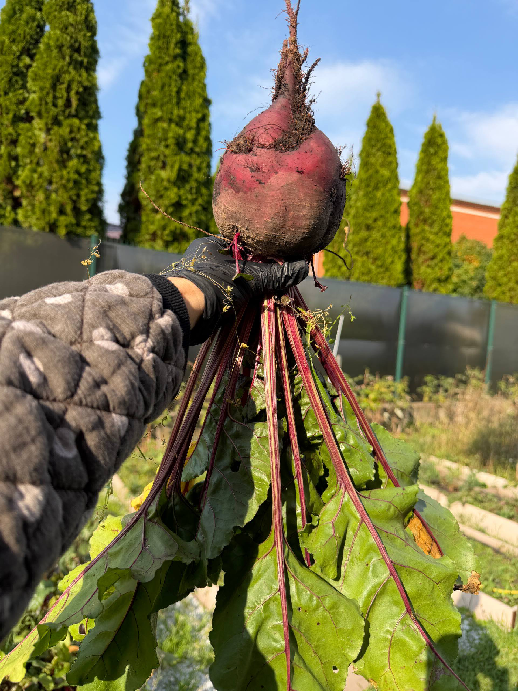 | 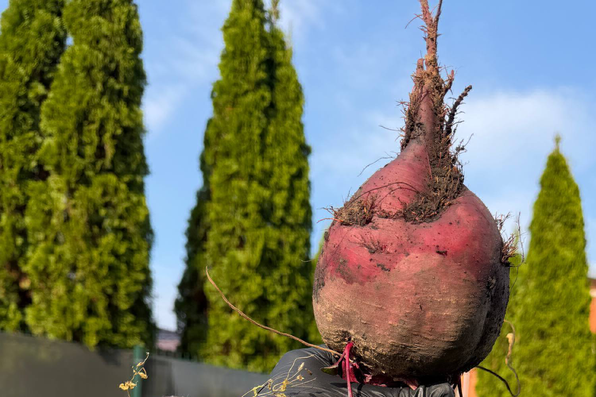 |

```bash
./image_processor mydata/beets.bmp filtred/beets.bmp -crop 1500 1000
```

### Негатив

| Оригинал | Результат |
| --- | --- |
| 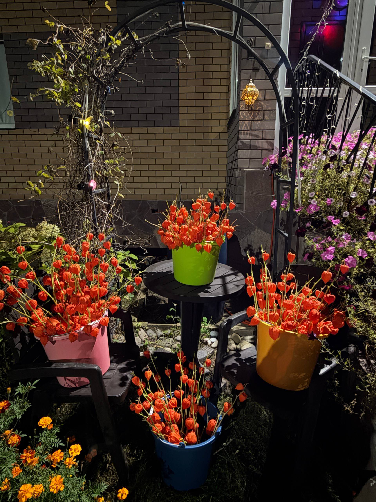 | 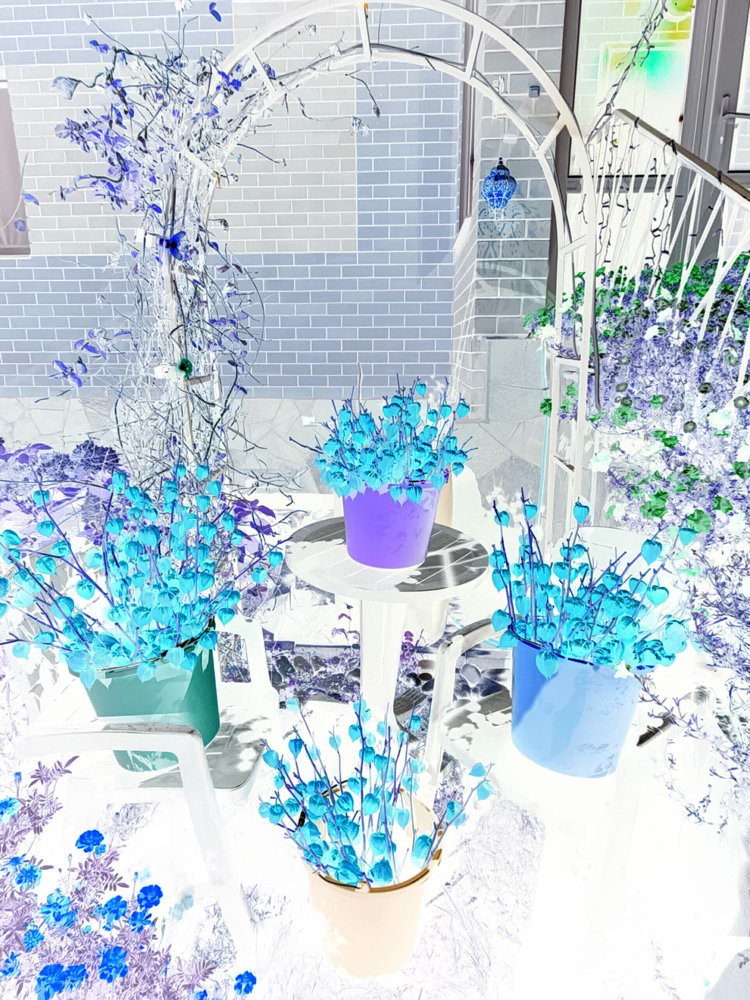 |

```bash
./image_processor mydata/china.bmp filtred/china.bmp -neg
```

### Выделение границ

| Оригинал | Результат |
| --- | --- |
| 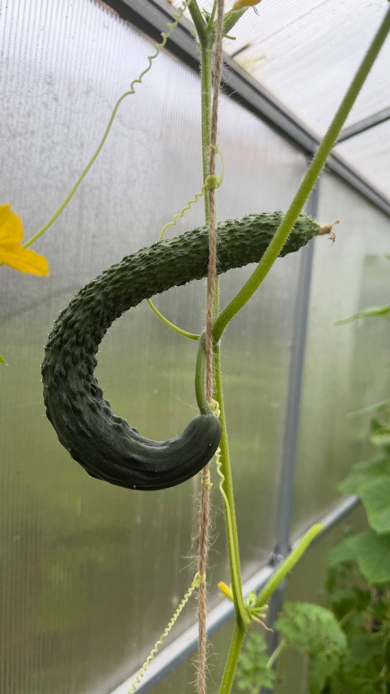 | 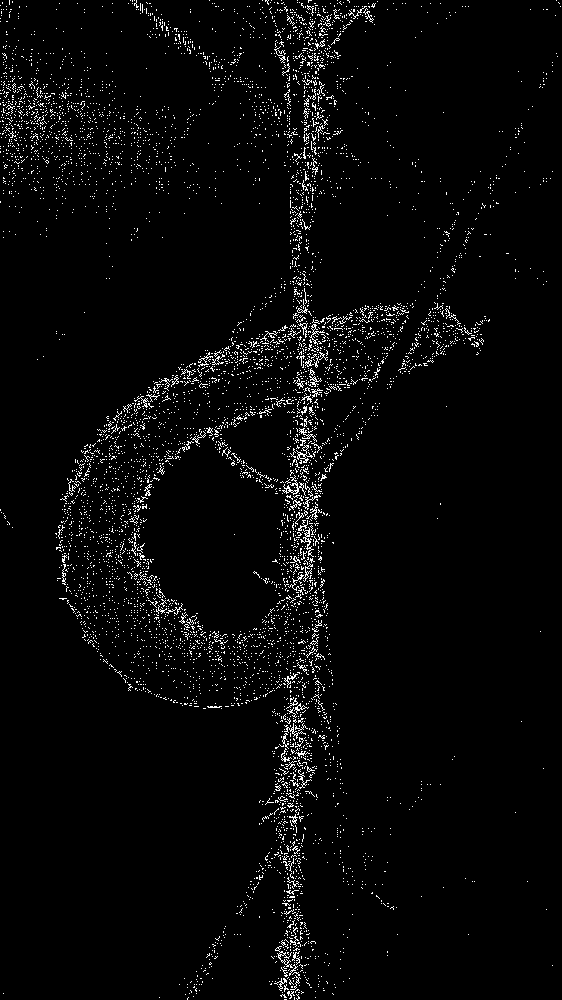 |

```bash
./image_processor mydata/cucumber.bmp filtred/cucumber.bmp -edge 0.07
```

### Повышение резкости (три применения)

| Оригинал | Результат |
| --- | --- |
| 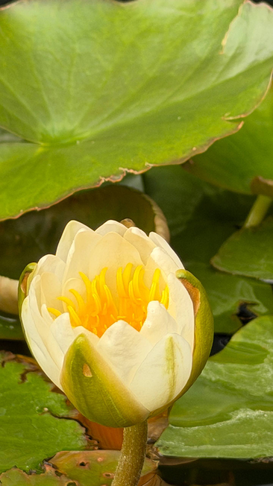 | 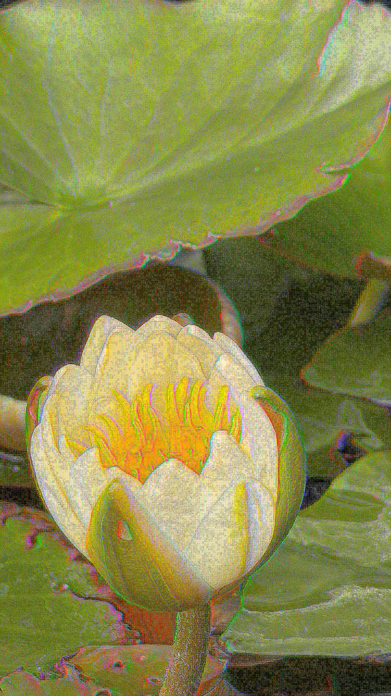 |

```bash
./image_processor mydata/flower.bmp filtred/flower.bmp -sharp -sharp -sharp
```

### Рельефное стекло

| Оригинал | Результат |
| --- | --- |
| 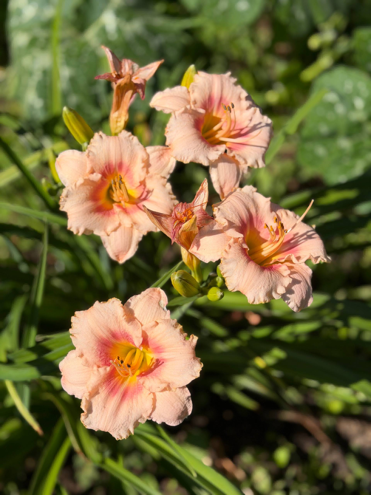 | 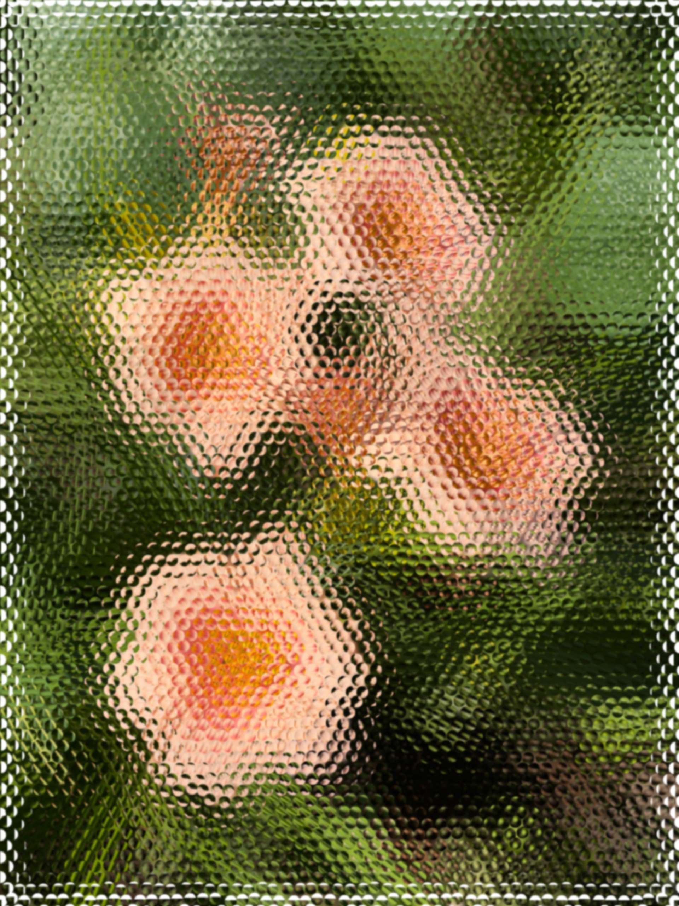 |

```bash
./image_processor mydata/flowers.bmp filtred/flowers.bmp -glass 17 2.2
```

### Оттенки серого

| Оригинал | Результат |
| --- | --- |
| 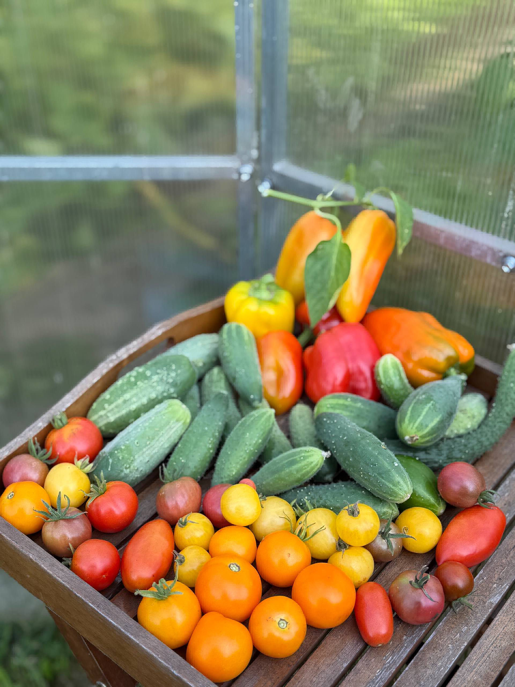 | 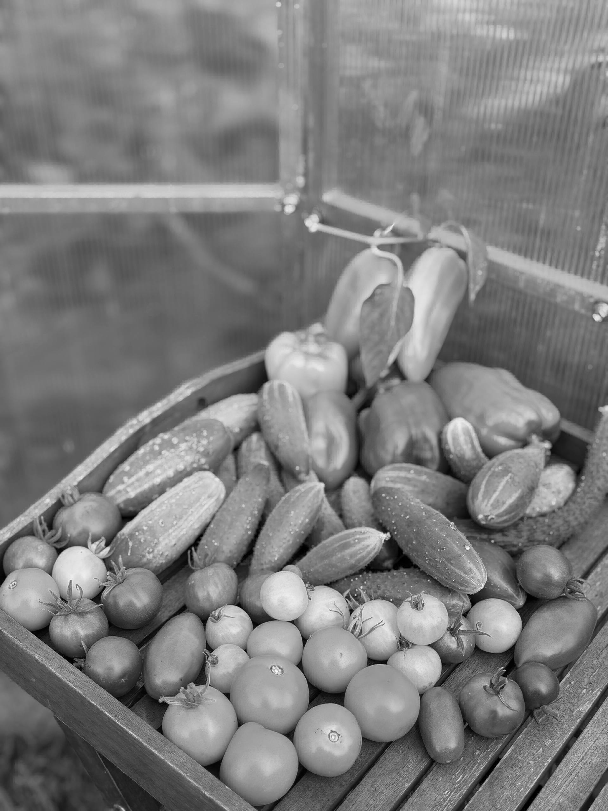 |

```bash
./image_processor mydata/table_with_fr_and_veg.bmp filtred/table_with_fr_and_veg.bmp -gs
```

### Размытие по Гауссу

| Оригинал | Результат |
| --- | --- |
| 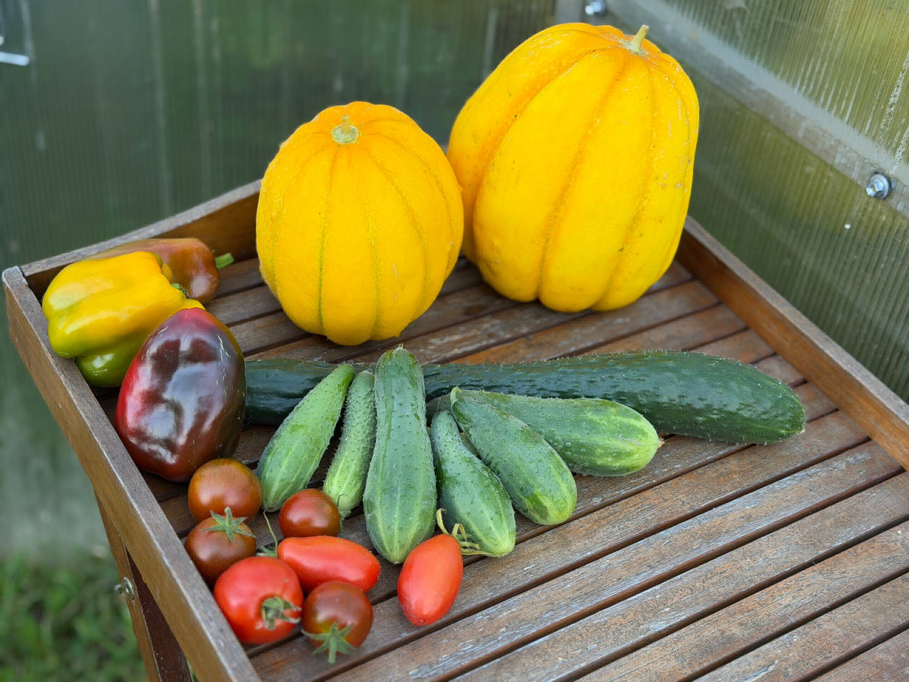 |  |

```bash
./image_processor mydata/table_with_vegetables.bmp filtred/table_with_vegetables.bmp -blur 13
```
